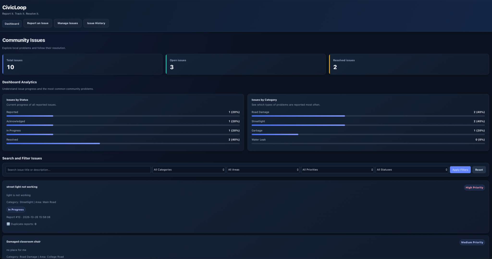
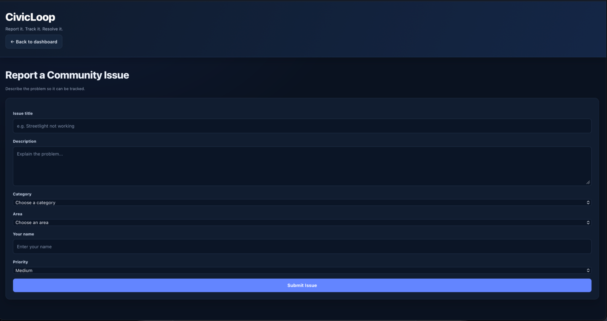
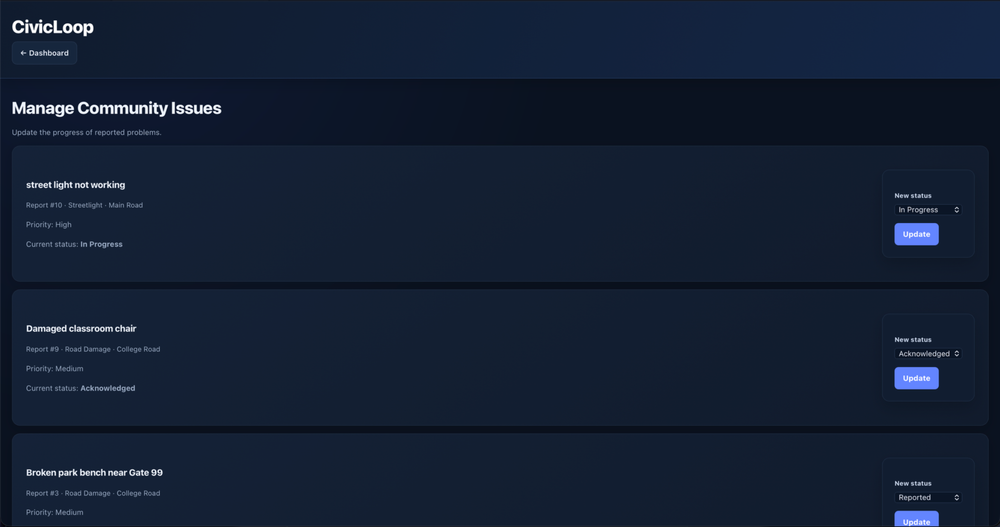
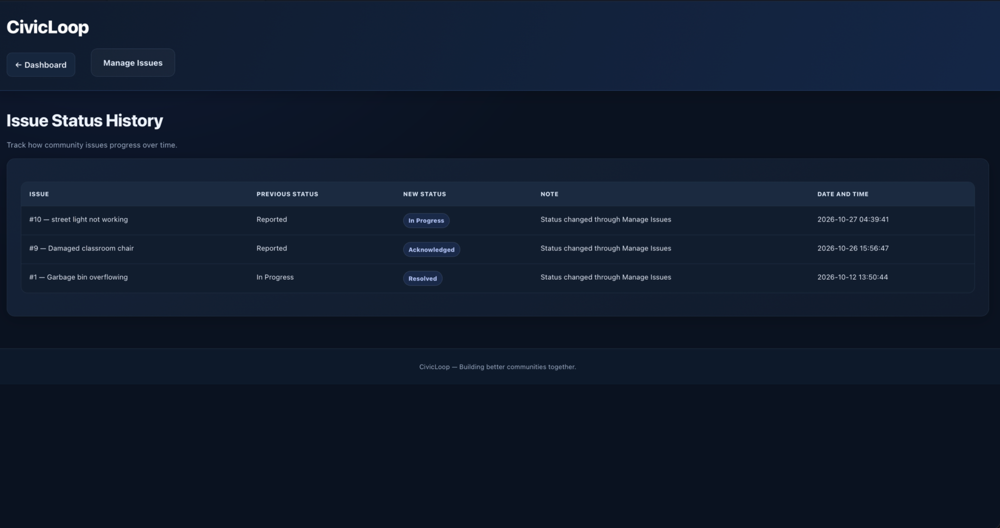

# CivicLoop — Report It. Track It. Resolve It.

A web-based civic issue reporting and tracking system built with **PHP and MySQL**. CivicLoop helps users report local community issues and provides a centralized interface to manage reports, track status updates, and review issue history.

**Live Demo:** https://civicloop-885q.onrender.com

## Overview

CivicLoop aims to make civic issue reporting more organized and transparent. Instead of leaving local problems untracked, the system provides a structured way to record issues, monitor their progress, and review changes over time.

The project includes a dashboard, issue reporting form, issue management interface, and issue history page, with a responsive Dark Premium user interface.

## Features

- **Dashboard:** View issue statistics and analytics at a glance.
- **Report an Issue:** Submit new civic issue reports through a dedicated form.
- **Issue Management:** View and manage reported issues.
- **Status Updates:** Update issue statuses as work progresses.
- **Duplicate Detection:** Help identify duplicate issue reports.
- **Issue History:** Review recorded issue history and status changes.
- **Database Integration:** Store and retrieve issue information using MySQL.
- **Responsive Design:** Use the application on desktop and mobile screens.
- **Dark Premium UI:** Consistent styling, readable forms, and clear status indicators.

## Technology Stack

| Technology | Purpose |
|---|---|
| PHP | Server-side application logic |
| MySQL | Database management |
| HTML5 | Page structure |
| CSS3 | Styling and responsive layouts |
| JavaScript | Client-side interactions, where implemented |
| Render | Live application hosting |
| Git and GitHub | Version control and collaboration |

## Application Pages

| Page | Description |
|---|---|
| Dashboard (`index.php`) | Overview of issues and statistics |
| Report an Issue (`report.php`) | Submit a new issue |
| Manage Issues (`manage.php`) | View and manage reported issues |
| Issue History (`history.php`) | Review issue history |

## Project Structure

```text
CivicLoop/
├── index.php
├── report.php
├── manage.php
├── history.php
├── db.php
└── static/
    └── css/
        └── civicloop-premium.css
```

*This shows the main files currently identified in the project. Add any other folders or files that exist in your repository.*

## Getting Started

### Prerequisites

- PHP with the required database extensions
- MySQL Server
- A web browser
- Git (optional, for cloning the repository)

### 1. Clone the repository

```bash
git clone <YOUR_GITHUB_REPOSITORY_URL>
cd CivicLoop
```

Replace the placeholder with your actual repository URL.

### 2. Configure the database

1. Create a MySQL database for CivicLoop.
2. Import or execute the project's database schema and setup SQL, if provided.
3. Configure the database connection in `db.php` using your local database settings.
4. Make sure the required tables are created before running the application.

**Security note:** Never commit database passwords, API keys, or other secrets to GitHub. Use environment variables or an appropriate secret-management method for deployment.

### 3. Start the PHP development server

From the project directory, run:

```bash
php -S localhost:8000
```

### 4. Open the application

Visit:

http://localhost:8000

For the hosted version, visit https://civicloop-885q.onrender.com.

## Database

CivicLoop uses MySQL to store application data. The project includes issue-related records and supporting data used by the reporting, management, and history features.

The exact schema and table relationships should be documented here based on the SQL files in the repository.

## Screenshots

Add screenshots of the actual running application to a `screenshots/` directory and embed them here.

### Dashboard


### Report an Issue


### Manage Issues


### Issue History


*Replace these image paths with your actual screenshot filenames. The images must be committed to the repository for them to display on GitHub.*

## Testing Checklist

- [ ] Dashboard loads and displays the expected statistics.
- [ ] New issue reports can be submitted.
- [ ] Duplicate detection behaves as expected.
- [ ] Issues appear in the management page.
- [ ] Issue status updates are saved correctly.
- [ ] Issue history displays the expected records.
- [ ] The layout works on desktop and mobile.
- [ ] The deployed application can connect to its database.

## Future Improvements

- User authentication and role-based access control
- Image uploads for issue reports
- Search, filtering, and sorting enhancements
- Notifications when issue statuses change
- Location-based issue mapping
- More detailed analytics and reporting
- Improved validation and security controls

## Learning Outcomes

This project provides practical experience with:

- PHP application development
- Relational database design and MySQL integration
- CRUD operations and form validation
- Building a responsive web interface
- Git-based collaboration and version control
- Deploying a web application

## Contributing

Contributions and suggestions are welcome.

1. Fork the repository.
2. Create a feature branch.
3. Make your changes and test them.
4. Submit a pull request describing your changes.

## License

No license has been specified yet. Add a license if you intend to distribute or reuse this project publicly.

---

**CivicLoop — Report It. Track It. Resolve It.**
## 📸 Project Screenshots

### 1. Dashboard
The dashboard displays total, open, and resolved issues, along with issue status analytics, category analytics, and search and filter controls.


### 2. Report an Issue
Users can report community problems by entering the issue title, description, category, area, name, and priority.


### 3. Manage Issues
The management page displays reported issues and allows the status of an issue to be updated.


### 4. Issue Status History
The history page shows previous and new statuses, notes, and timestamps for issue updates.


## 🌐 Live Demo

**Live Website:** https://civicloop-885q.onrender.com

## 🛠️ Technology Stack

- PHP
- MySQL
- HTML5
- CSS3
- Git and GitHub
- Render
## 📸 Project Screenshots

### 1. Dashboard
Displays total issues, open and resolved issues, status analytics, category analytics, and search filters.


### 2. Report an Issue
Allows users to submit civic problems with a title, description, category, area, reporter name, and priority.


### 3. Manage Issues
Displays reported issues and provides controls to update their statuses.


### 4. Issue Status History
Displays previous and new statuses, notes, and timestamps for issue updates.


## 🌐 Live Demo

**Live Website:** https://civicloop-885q.onrender.com
